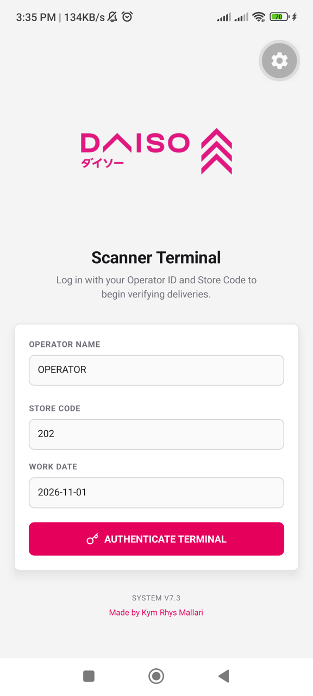
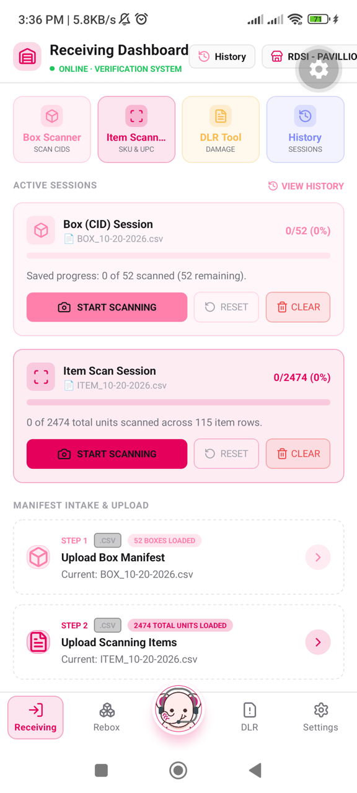
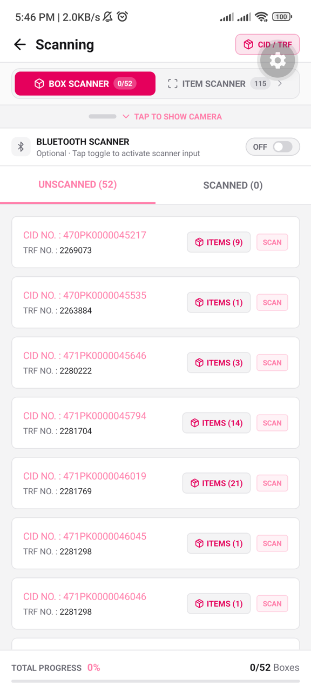
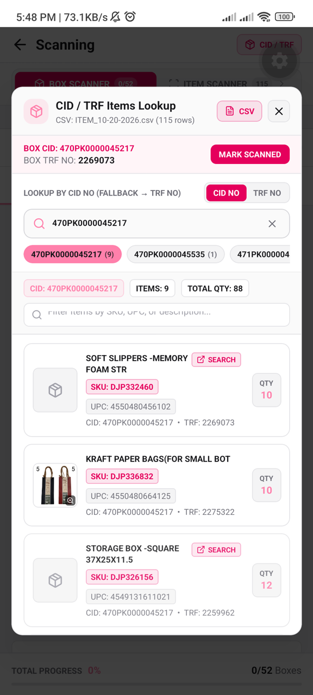
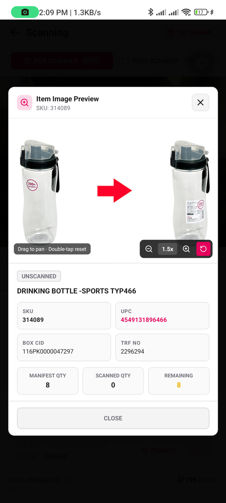
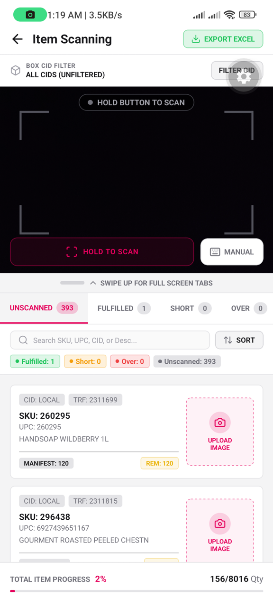
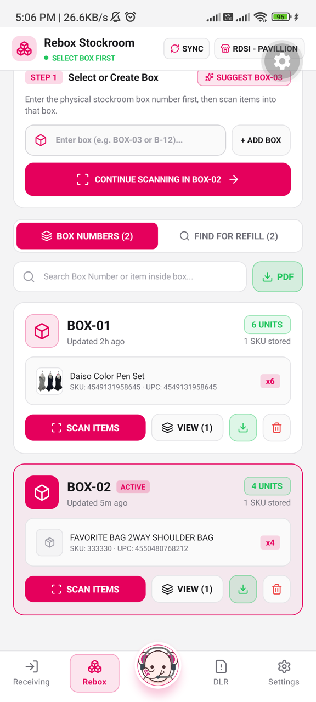
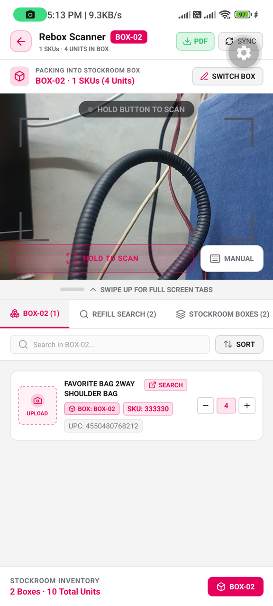
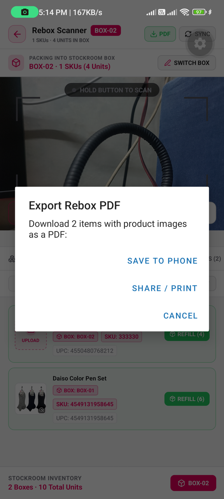

# Receiving & Delivery Scanner App (Daizo) — v7.4

An industrial-grade, offline-first mobile application built with **React Native** and **Expo** for retail store receiving, carton/box verification, SKU/UPC barcode tallying, stockroom rebox packing & PDF manifest generation, damage/loss claims (DLR), and on-device AI assistance.

---

## 📱 What is this App For?

In retail and warehouse logistics, receiving stock deliveries and organizing backroom stock quickly and accurately is critical. This application replaces manual paper manifests and clunky handheld terminals with a modern, ruggedized smartphone scanner:

1. **Manifest Intake & Verification**: Import delivery manifests (`.csv` / `.xlsx`) and scan incoming carton barcodes (`CID NO` / `TRF NO`) and individual product barcodes (`SKU` / `UPC`).
2. **Conditional `CID NO` → `TRF NO` Cross-Reference**: Inspect expected items inside any box starting with `CID NO` lookup and automatically falling back to `TRF NO` when needed—or manually switch with the `CID NO` | `TRF NO` toggle.
3. **Rebox Stockroom Hub & Embedded-Photo PDF Export**: Register stockroom box numbers first, scan items with automatic OpenSheet & manifest lookup, upload missing product photos (`daisoimage`), hold `3s` to delete cards, and export printable PDF reports with embedded product photos.
4. **Discrepancy Detection**: Instantly surfaces `UNSCANNED`, `FULFILLED`, `SHORT`, and `OVER` items with high-contrast badges and haptic feedback.
5. **Damage & Lost Record (DLR) Claims**: Document damaged, open, or missing inventory at the receiving dock with 3-photo proof and strict store-code cloud isolation.
6. **Offline Local AI Assistant (Daizo)**: Ask English or Taglish questions about manifests, `SKU ↔ UPC` lookups, or remaining boxes completely offline via on-device `SmolLM2-360M` (`llama.rn`).

---

## 📸 App Screenshots

### Authentication, Receiving Dashboard & Box Scanning
| 1. Scanner Terminal Login | 2. Receiving Dashboard | 3. Box (`CID`) Scanner |
| :---: | :---: | :---: |
|  |  |  |
| Sign in with Operator Name & validated Store Code | Upload Box/Item CSVs, resume sessions & open History | Track Unscanned/Scanned cartons & toggle Bluetooth gun |

### Conditional `CID / TRF` Lookup, Image Zoom & Item Scanning
| 4. `CID / TRF` Items Lookup | 5. Interactive Image Zoom | 6. Item (`SKU / UPC`) Scanner |
| :---: | :---: | :---: |
|  |  |  |
| Conditional `CID NO` → `TRF NO` fallback & mode toggle | Pinch-to-zoom (`1.0x–4.0x`), pan & full item specs | Live `Unscanned / Fulfilled / Short / Over` tally & Excel export |

### Rebox Stockroom Hub, Per-Box Packing & PDF Export
| 7. Rebox Stockroom Hub | 8. Rebox Per-Box Scanner | 9. Export PDF with Photos |
| :---: | :---: | :---: |
|  |  |  |
| Create/select stockroom boxes & search items for refill | Scan items into active box, upload UPC photos & hold `3s` to delete | Save PDF directly to phone (`Documents`) or share/print |

---

## 📖 How to Use the App (Operator Guide)

> 🇵🇭 **Para sa ating mga kasama sa DAISO JAPAN:**  
> Basahin ang kumpletong Taglish tutorial dito: 👉 **[Gabay sa Paggamit (Taglish Guide)](docs/TUTORIAL_TAGLISH.md)**  
> O kaya ay i-download at i-print ang PDF format: 📄 **[Download Tutorial PDF (Taglish)](docs/TUTORIAL_TAGLISH.pdf)**

### Step 1: Authenticate the Scanner Terminal
1. Open the app to reach the **Scanner Terminal** login screen.
2. Enter your **Operator Name** (e.g., `JUAN DELA CRUZ`) and 3-digit **Store Code** (e.g., `202` — validated against the official `store.json` directory).
3. Verify the auto-filled **Work Date** (`YYYY-MM-DD`) and tap **`AUTHENTICATE TERMINAL`**.

---

### Step 2: Upload Delivery Manifests (`Receiving` Tab)
1. On the **Receiving Dashboard**, scroll to **Manifest Intake & Upload**:
   - **Step 1 — Upload Box Manifest**: Pick your Box `.csv` file containing `CID NO` (and optional `TRF NO`) columns.
   - **Step 2 — Upload Scanning Items**: Pick your Item `.csv` file containing `CID NO`, `TRF NO`, `UPC`, `SKU`, `DESCRIPTION`, and `QTY` columns.
2. Once loaded, active progress cards appear under **Active Sessions** showing how many boxes and units remain.
3. Tap **`START SCANNING`** on either session card (or use the top quick-action tiles).

---

### Step 3: Verify Incoming Cartons (`Box Scanner`)
1. **Scan a Box Barcode**:
   - **Camera**: Point the camera at the carton label and press & hold **`HOLD TO SCAN`**.
   - **Manual Entry**: Tap **`MANUAL`** to type a `CID NO` or `TRF NO`.
   - **Bluetooth Barcode Gun**: Swipe up (or tap **`TAP FOR FULL SCREEN TABS`**) and switch **`BLUETOOTH SCANNER`** ON (`0.5s` smart buffer captures rapid hardware scans automatically).
2. **Inspect Items Inside a Box (`CID / TRF Lookup`)**:
   - Tap **`ITEMS (N)`** on any box row, or tap **`CID / TRF`** in the top-right header.
   - **Conditional Lookup**: The modal checks **`CID NO`** first so multi-TRF boxes display all items accurately; if nothing matches `CID NO`, it automatically switches to **`TRF NO`** and displays **`NO CID MATCH · SWITCHED TO TRF`**.
   - **Manual Mode Toggle**: Tap the **`CID NO` | `TRF NO`** segmented toggle button at any time to switch modes and browse quick-select code chips.
3. **Preview Product Photos or Search Web**:
   - Tap an item with a thumbnail to open **Item Image Preview** (pinch or tap `+` / `-` to zoom up to `4.0x`, drag to pan, double-tap to reset).
   - If an item has no photo on CDN, tap **`SEARCH`** on the card to open an in-app Google Images search for its `UPC`.

---

### Step 4: Tally Individual Products (`Item Scanner`)
1. **Fast Switch**: Swipe **left** anywhere on `Box Scanner` (or tap the **`ITEM SCANNER`** tab at the top) to jump straight into item scanning.
2. **Scan Products**: Hold **`HOLD TO SCAN`** (or use Bluetooth / `MANUAL`) to scan product `UPC` or `SKU` barcodes. Leading zeros (e.g., `000260295` → `260295`) are normalized automatically.
3. **Monitor Discrepancies**: Filter items across **`UNSCANNED`**, **`FULFILLED`**, **`SHORT`**, and **`OVER`** tabs, or filter by a specific **`BOX CID`**.
4. **Upload Missing Photos & Export**:
   - Tap **`UPLOAD IMAGE`** on any item card without a photo to capture a `1:1` product image.
   - Tap **`EXPORT EXCEL`** in the top-right header to export your verified item counts.

---

### Step 5: Organize Backroom Inventory (`Rebox` Tab)
1. **Create or Select a Box First**:
   - Open the **`Rebox`** bottom tab (**Rebox Stockroom**).
   - Enter a physical stockroom box label (e.g., `BOX-01`, `B-12`, or tap **`SUGGEST BOX-03`**) and tap **`+ ADD BOX`**.
   - Tap **`SCAN ITEMS`** on a box card (or **`CONTINUE SCANNING IN BOX-XX`**) to open the dedicated **Rebox Scanner** for that box.
2. **Scan & Pack Items**:
   - Scan item barcodes (`UPC` or `SKU`) via camera or **`MANUAL`**. Product `DESCRIPTION`, `SKU`, `UPC`, and existing images are resolved automatically from the **OpenSheet catalog** and manifest.
   - Adjust packed quantities anytime using the **`-`** and **`+`** buttons, or tap **`SWITCH BOX`** to move to another box.
3. **Upload Missing Item Photos (`daisoimage`)**:
   - If an item shows **`UPLOAD`**, tap it—the app first checks whether an image already exists on Daiso/Cloudinary CDNs, and if missing, lets you capture/upload a photo named after the item's `UPC` (`EXPO_CLOUDINARY_UPLOAD_PRESET=daisoimage`).
4. **Delete an Item (3-Second Hold)**:
   - **Press and hold any Rebox item card for `3 seconds`**. A live red progress bar fills across the bottom of the card (`HOLD 3S TO DELETE...`) before removing it from local storage and Supabase (`rebox_items`), preventing accidental taps.
5. **Find Items for Shelf Refill**:
   - Switch to the **`FIND FOR REFILL`** / **`REFILL SEARCH`** tab and type or scan a `SKU`, `UPC`, or product name to immediately see which stockroom box (`BOX-01`, `BOX-02`, etc.) stores that item and how many units are available.
6. **Download or Share PDF with Images**:
   - Tap the green **`PDF`** button (on **Rebox Stockroom** to export all store boxes, or inside **Rebox Scanner** to export the active box).
   - Choose **`SAVE TO PHONE`** (select your `Documents` folder via Android Storage Access Framework) or **`SHARE / PRINT`** to share via Viber, Email, Drive, or wireless printer.
   - Tap **`SYNC`** to synchronize your store's Rebox inventory with Supabase (`storeCode`-scoped).

---

### Step 6: Report Damaged or Missing Goods (`DLR` Tab)
1. Tap the **`DLR`** bottom tab (or **`DLR Tool`** on the Receiving Dashboard).
2. Scan or type the affected item's `SKU` / `UPC` to auto-fill catalog details, choose the defect/loss reason, and enter the affected quantity.
3. Capture the **3 required evidence photos** (`Quantity`, `Damage`, and `Barcode`) and submit to sync with your store's isolated cloud DLR log.

---

### Step 7: Ask Daizo Offline AI Assistant (Center Mascot Tab)
1. Tap the center **Daizo** button on the bottom navigation bar from any screen.
2. Ask questions in **English or Taglish**—completely offline:
   - *"Anong SKU nito UPC 4550480272467?"*
   - *"Anong UPC nito SKU 322462?"*
   - *"How many boxes and items are still unscanned?"*

---

### Step 8: Session History, Themes & App Updates
- **Resume Past Sessions**: Tap **`History`** (or **`VIEW HISTORY`**) on the Receiving Dashboard to inspect previous receiving runs or reload a saved session.
- **Themes & Updates**: Open the **`Settings`** tab to switch between **Dark Mode**, **Light Mode**, or **System**, tap **`CHECK FOR UPDATES`** for OTA APK releases, or tap **`TERMINATE SESSION (LOG OUT)`** at the end of your shift.

---

## 🛠 Tech Stack

| Layer | Technology |
| :--- | :--- |
| **Framework** | [React Native 0.85.3](https://reactnative.dev/) / [Expo SDK 56](https://expo.dev/) (Dev Client) |
| **Language** | [TypeScript 6.0](https://www.typescriptlang.org/) |
| **Styling** | [NativeWind v4](https://www.nativewind.dev/) (Tailwind CSS 3.4) |
| **Navigation** | [React Navigation 7](https://reactnavigation.org/) (Stack & Safe-Area Bottom Tabs) |
| **Local AI Engine** | [`llama.rn`](https://github.com/mybigday/llama.rn) (`llama.cpp` C++ bindings) |
| **AI Model** | `SmolLM2-360M-Instruct-Q4_K_M.gguf` (quantized on-device GGUF) |
| **Database & Cloud** | [Supabase](https://supabase.com/) (`@supabase/supabase-js`), Cloudinary CDN, OpenSheet Catalog |
| **Hardware & Media APIs** | `expo-camera`, `expo-image`, `expo-image-manipulator`, `expo-haptics`, `expo-file-system`, `expo-sharing`, `expo-web-browser` |
| **File Parsing & Export** | `papaparse` (CSV), `xlsx` (Excel), Custom Binary PDF 1.4 Engine (`utils/rebox.ts`) |

---

## 📂 Project Structure

```
receiving-delivery-app/
├── assets/                   # App icons, splash screens, Daizo avatars, GGUF models
├── components/               # Reusable UI widgets & modal dialogs
│   ├── HistoryModal.tsx      # Past receiving session audit & resume modal
│   ├── LocalAiFabModal.tsx   # Daizo on-device AI chat modal
│   └── ...
├── context/                  # React Context Providers
│   ├── aiAssistant.tsx       # Daizo AI state and chat management
│   ├── auth.tsx              # Operator credentials & store authentication
│   └── theme.tsx             # Dark / Light / System theme provider
├── docs/
│   └── screenshots/          # App workflow screenshots referenced in README
├── navigation/               # Navigation stacks & safe-area bottom tab bar
│   ├── index.tsx             # Root stack (Tabs, ScanningBox, ScanningItem, ReboxScanner, DLR)
│   └── tab-navigator.tsx     # Receiving, Rebox, Daizo AI, DLR, Settings tabs
├── screens/                  # Main feature screens
│   ├── damageLostRecord.tsx  # DLR defect reporting & photo proof
│   ├── login.tsx             # Operator sign-in & store code validator
│   ├── one.tsx               # Receiving hub, manifest importer & History trigger
│   ├── reboxScanner.tsx      # Dedicated per-box Rebox barcode scanner & PDF export
│   ├── scanningBox.tsx       # Carton CID/TRF scanner & conditional CID → TRF item lookup
│   ├── scanningItem.tsx      # Item SKU/UPC barcode scanner & 1:1 photo uploader
│   ├── two.tsx               # Rebox Hub (box registration, catalog sync, All-Boxes PDF export)
│   └── three.tsx             # Terminal settings, theme switcher & OTA update checker
├── services/                 # App update checker (semver) & local AI inference services
├── utils/                    # Core domain & persistence utilities
│   ├── dlr.ts                # Supabase client, OpenSheet catalog cache, DLR & Cloudinary helpers
│   ├── rebox.ts              # Rebox storage/Supabase sync, UPC photo check/upload & PDF 1.4 generator
│   └── storage.ts            # AsyncStorage keys, manifest interfaces & session history helpers
├── DESIGN.md                 # Visual design tokens & brand guidelines
├── TASK.md                   # Architecture spec for local LLM & data flow
└── RELEASE.md                # Version changelog, git tag & Supabase release instructions
```

---

## 🚦 Getting Started (Developers)

### Prerequisites
- Node.js (v18 or v20 recommended)
- Android SDK (for physical device or Android emulator testing)
- Xcode (macOS only, for iOS builds)
- Expo Dev Client *(Note: `llama.rn` requires native C++ bindings and cannot run inside Expo Go)*

### Installation
1. Clone the repository:
   ```bash
   git clone https://github.com/KymRhys2k22/receiving-delivery-app.git
   cd receiving-delivery-app
   ```

2. Install dependencies:
   ```bash
   npm install --legacy-peer-deps
   ```

3. Configure environment variables:
   Copy `.env.example` to `.env` and fill in your Supabase and Cloudinary credentials:
   ```env
   EXPO_PUBLIC_SUPABASE_URL=https://your-project.supabase.co
   EXPO_PUBLIC_SUPABASE_ANON_KEY=your-anon-key
   EXPO_PUBLIC_CLOUDINARY_CLOUD_NAME=your-cloud-name
   EXPO_PUBLIC_CLOUDINARY_UPLOAD_PRESET=your-dlr-preset
   EXPO_CLOUDINARY_UPLOAD_PRESET=daisoimage
   ```

4. Build & run the Dev Client:
   ```bash
   # Android
   npx expo run:android

   # iOS
   npx expo run:ios
   ```

---

## 🧪 Testing on Physical Devices
To test with Android wireless ADB and `agent-device`:
```bash
adb connect <device-ip>:<port>
npx expo start
```

---

## 👤 Author & Portfolio

Developed by **Kym Rhys Mallari**  
🌐 **Portfolio Website**: [kym-rhys.vercel.app](https://kym-rhys.vercel.app/)  
GitHub: [@KymRhys2k22](https://github.com/KymRhys2k22)
