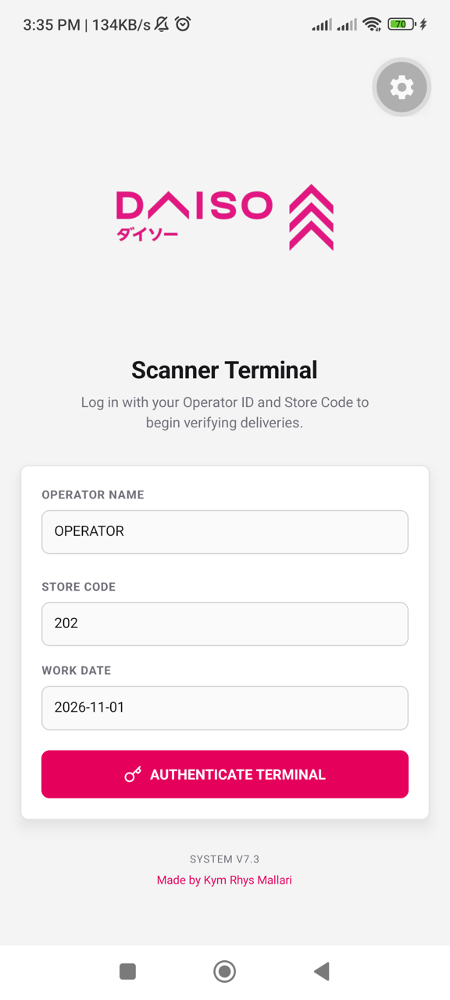
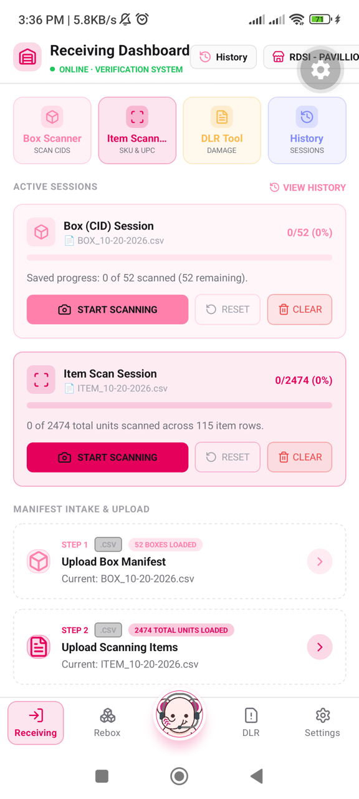
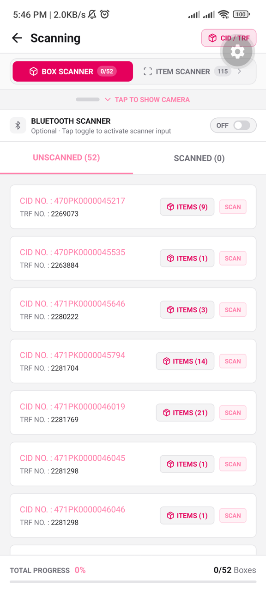
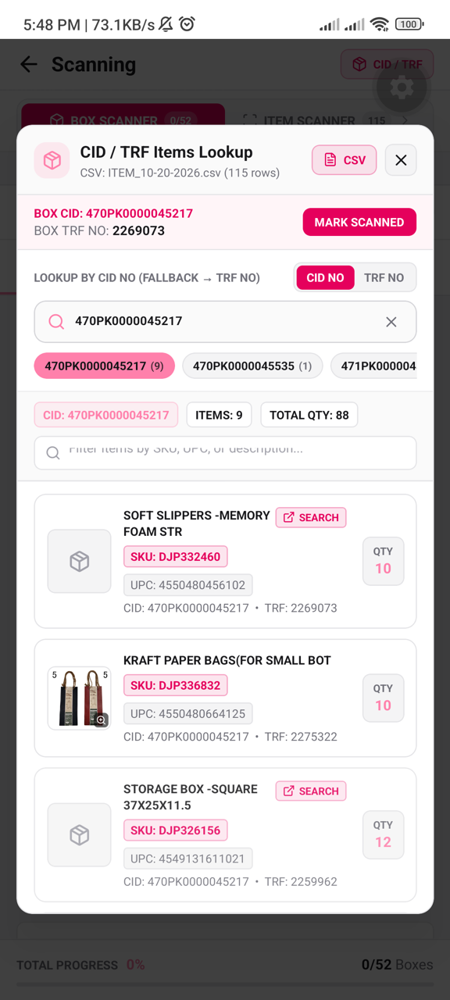
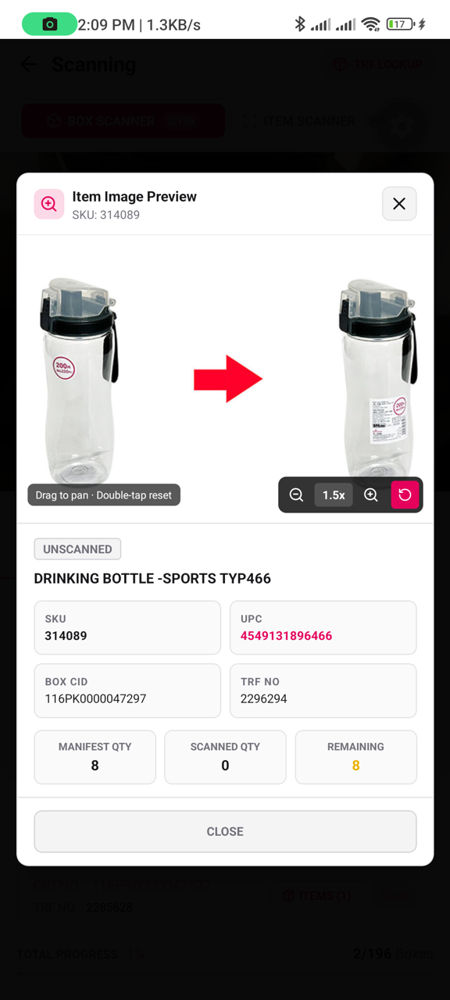
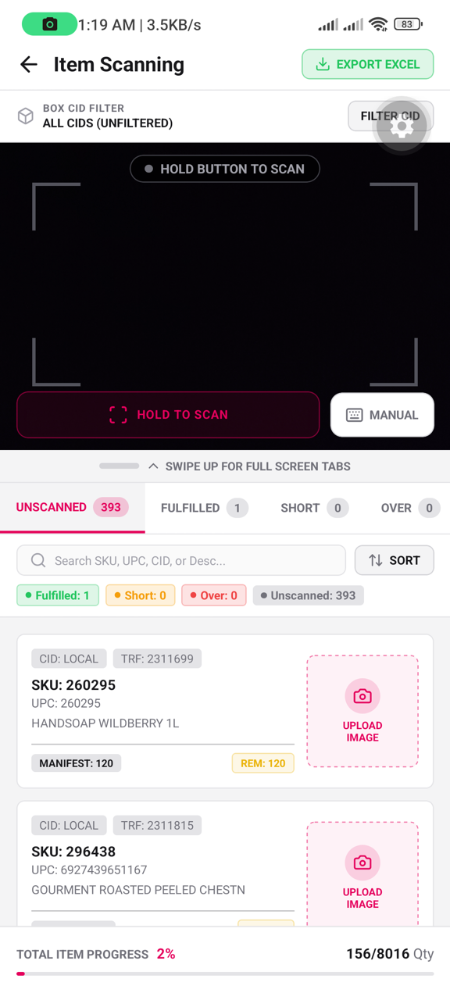
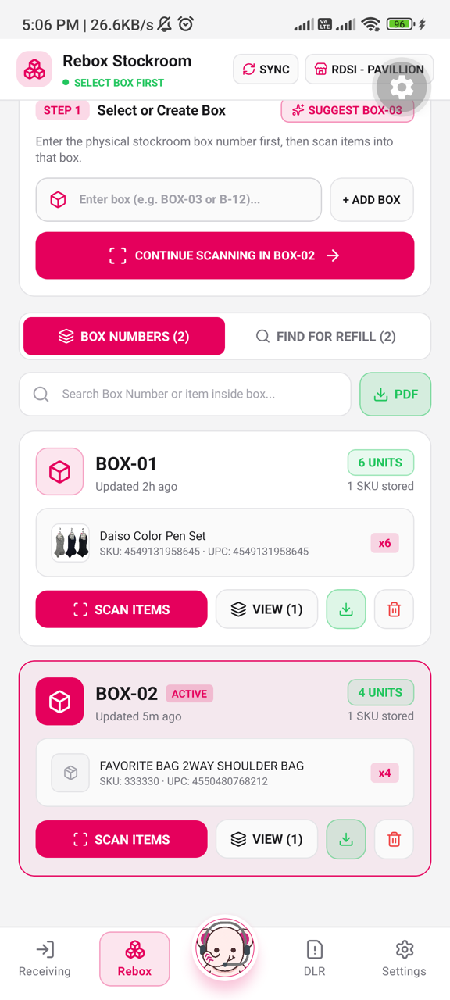
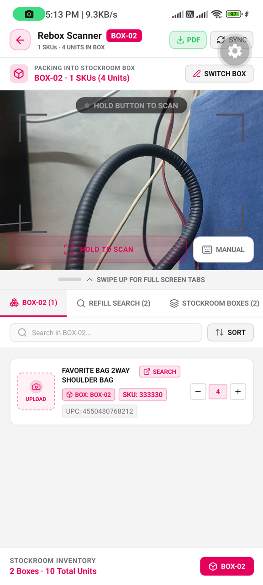
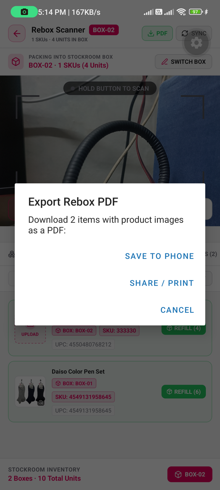

# 📖 Gabay sa Paggamit ng Receiving & Delivery App (Daiso Japan)
### *Tutorial para sa mga Stockroom Clerks, Receivers, at Store Operations Team*
**Bersyon ng App:** v7.4 (Build 12) · **May-akda:** Kym Rhys Mallari

---

## 🌸 Maligayang Pagdating sa Daizo Receiving Scanner!

Ginawa ang app na ito para mapadali, mapabilis, at maging 100% accurate ang ating delivery receiving, box verification, item tallying, at stockroom reboxing sa **Daiso Japan**.

Hindi mo na kailangang mag-mano-mano ng papel na packing list o magbilang sa notebook. Diretso na sa phone ang barcode scanning, automatic catalog lookup, at **pag-download ng PDF manifest na may kasamang pictures ng mga items**!

---

## 📑 Talaan ng Nilalaman (Quick Links)
1. [Hakbang 1: Pag-login sa Scanner Terminal](#hakbang-1-pag-login-sa-scanner-terminal)
2. [Hakbang 2: Pag-upload ng Manifest CSV](#hakbang-2-pag-upload-ng-manifest-csv)
3. [Hakbang 3: Box (Carton) Scanning at CID / TRF Lookup](#hakbang-3-box-carton-scanning-at-cid--trf-lookup)
4. [Hakbang 4: Item Scanning at Discrepancy Tracking](#hakbang-4-item-scanning-at-discrepancy-tracking)
5. [Hakbang 5: Rebox Stockroom Packing (Box-First Workflow)](#hakbang-5-rebox-stockroom-packing-box-first-workflow)
6. [Hakbang 6: Pag-upload ng Picture ng Item sa Cloudinary (daisoimage)](#hakbang-6-pag-upload-ng-picture-ng-item-sa-cloudinary-daisoimage)
7. [Hakbang 7: Pag-delete ng Item gamit ang 3-Seconds Hold Gesture](#hakbang-7-pag-delete-ng-item-gamit-ang-3-seconds-hold-gesture)
8. [Hakbang 8: Pag-export at Pag-download ng PDF na may Pictures](#hakbang-8-pag-export-at-pag-download-ng-pdf-na-may-pictures)
9. [Hakbang 9: Find for Refill (Paghahanap ng Items sa Stockroom)](#hakbang-9-find-for-refill-paghahanap-ng-items-sa-stockroom)
10. [Hakbang 10: DLR (Damage & Lost Record Tool)](#hakbang-10-dlr-damage--lost-record-tool)
11. [Hakbang 11: Pagtatanong kay Daizo (Offline AI Assistant)](#hakbang-11-pagtatanong-kay-daizo-offline-ai-assistant)

---

## Hakbang 1: Pag-login sa Scanner Terminal

Bago mag-umpisa mag-scan, kailangan munang mag-login para malaman ng system kung anong store branch at sino ang nagre-receive.

  

1. **OPERATOR NAME**: I-type ang iyong pangalan (Halimbawa: `JUAN DELA CRUZ`).
2. **STORE CODE**: Ilagay ang official 3-digit store code ng iyong branch (Halimbawa: `202` para sa *RDSI - PAVILLION*).
   > *Paalala:* Naka-link ito sa ating official store directory (`store.json`). Kung mali ang nailagay na code, magkakaroon ng red warning banner.
3. **WORK DATE**: Kusa itong naka-set sa petsa ngayon (`YYYY-MM-DD`).
4. Pindutin ang pink button na **`AUTHENTICATE TERMINAL`**. Magpapakita ang welcome screen at dadalhin ka sa Receiving Dashboard.

---

## Hakbang 2: Pag-upload ng Manifest CSV

Sa **Receiving Dashboard**, dito natin ilalagay ang delivery manifest para alam ng app kung aling mga kahon at piraso ang inaasahan mula sa warehouse o delivery truck.

  

1. Mag-scroll pababa sa seksyon ng **MANIFEST INTAKE & UPLOAD**:
   - **STEP 1 · Upload Box Manifest**: Piliin ang file na naglalaman ng mga carton box numbers (`CID NO` at `TRF NO`, halimbawa: `BOX_10-20-2026.csv`).
   - **STEP 2 · Upload Scanning Items**: Piliin ang file na naglalaman ng listahan ng mga items (`UPC`, `SKU`, `DESCRIPTION`, at `QTY`, halimbawa: `ITEM_10-20-2026.csv`).
2. Kapag na-upload na, lalabas sa itaas ang **Active Sessions** na may kulay pink na card:
   - Makikita mo agad kung ilang kahon ang natitira (`0/52 scanned (52 remaining)`).
   - Makikita rin kung ilang total units ang kailangang i-tally (`0/2474 total units`).
3. Pindutin ang **`START SCANNING`** para mag-umpisa!

---

## Hakbang 3: Box (Carton) Scanning at CID / TRF Lookup

Ito ang screen kung saan natin chine-check ang mga master box / delivery cartons.

  

### Paano mag-scan ng Box:
* **Camera Scanning**: Itapat ang camera sa barcode ng kahon at **pindutin at i-hold ang `HOLD TO SCAN`**. Magkakaroon ng red laser guide habang naka-hold.
* **Manual Input**: Kung punit o malabo ang barcode, pindutin ang **`MANUAL`** sa ibaba at i-type ang numero ng kahon.
* **Bluetooth Scanner Gun**: Kung may wireless barcode gun ka, i-swipe pataas ang tabs at i-on ang **`BLUETOOTH SCANNER`**. Mabilis nitong babasahin ang mga sunod-sunod na scan sa loob ng 0.5 segundo.

---

### Paano malaman kung anong laman ng Box? (`CID / TRF Items Lookup`)

Minsan ang isang kahon (`CID NO`) ay may laman na items mula sa iba't ibang transfer numbers (`TRF NO`). May bagong feature ang ating app para dito!

  

1. Pindutin ang **`ITEMS (N)`** button sa tabi ng kahon, o pindutin ang **`CID / TRF`** sa kanang itaas ng header.
2. **Automatic Conditional Fallback (`CID NO` → `TRF NO`)**:
   - Uunahin ng app na hanapin ang laman gamit ang **CID NO**.
   - Kapag walang direct CID match sa CSV, **kusa itong magpapalit sa TRF NO** at magpapakita ng dilaw na badge: **`NO CID MATCH · SWITCHED TO TRF`**.
3. **Manual Toggle Button**:
   - Pwede mong pindutin ang toggle button sa itaas: **`CID NO`** o **`TRF NO`** para magpalit ng paraan ng paghahanap.
   - Pwede mo ring i-tap ang mga quick chips sa ilalim ng search bar para mabilisang tingnan ang ibang kahon.
4. **Pagsilip sa Picture ng Item**:
   - I-tap ang card ng item para buksan ang **Item Image Preview** (pwede mong i-pinch para i-zoom hanggang `4.0x`).
   - Kung walang litrato ang item sa database, may lalabas na pink button na **`SEARCH`**. Pag pinindot mo ito, bubuksan nito ang Google Images gamit ang UPC ng item sa loob mismo ng app!

  

---

## Hakbang 4: Item Scanning at Discrepancy Tracking

Pagkatapos i-verify ang mga kahon, i-tally naman natin ang bawat piraso ng produkto sa loob.

  

1. **Mabilisang Paglipat**: Mula sa Box Scanner, i-swipe lang pakaliwa ang screen (o i-tap ang **`ITEM SCANNER`** tab sa itaas).
2. **I-scan ang Bawat Produkto**:
   - I-scan ang barcode gamit ang **`HOLD TO SCAN`** o ang Bluetooth gun.
   - Kusa nang tinatanggal ng system ang leading zeros (halimbawa: `000260295` ay babasahin bilang `260295`), kaya tugma agad sa system kahit iba ang format ng barcode sa packaging.
3. **Subaybayan ang Discrepancies**:
   - **`UNSCANNED`**: Mga items na hindi pa nabibilang.
   - **`FULFILLED`**: Kumpleto ang bilang base sa manifest.
   - **`SHORT`**: Kulang ang delivery kumpara sa order.
   - **`OVER`**: Sobra ang delivery kaysa sa manifest.
4. Pindutin ang **`EXPORT EXCEL`** sa kanang itaas kung kailangan mong ipadala ang receiving tally report sa head office.

---

## Hakbang 5: Rebox Stockroom Packing (Box-First Workflow)

Kapag nag-aayos tayo ng stockroom o nagba-box ng excess inventory papunta sa bodega, gamitin ang **Rebox** tab (pangalawang icon sa ibabang menu).

  

### Step-by-Step sa Pag-Rebox:
1. **Gumawa o Pumili ng Kahon Muna (Box-First)**:
   - Sa **Rebox Stockroom Hub**, ilagay ang pangalan o code ng pisikal na kahon (halimbawa: `BOX-01`, `B-02`, o i-tap ang **`SUGGEST BOX-03`**).
   - Pindutin ang **`+ ADD BOX`**.
2. **Buksan ang Scanner para sa Kahon**:
   - Pindutin ang **`SCAN ITEMS`** sa card ng kahon.
   - Bubukas ang **Rebox Scanner** na nakatutok lang sa kahong iyon (halimbawa: `BOX-02`).

  

3. **I-scan ang mga Produkto**:
   - Itapat sa barcode at i-hold ang **`HOLD TO SCAN`**.
   - **Kusa nitong kukunin ang Description, SKU, UPC, at picture** galing sa ating Daiso OpenSheet catalog at manifest!
   - Gamitin ang **`+`** at **`-`** buttons sa card kung gusto mong dagdagan o bawasan ang dami ng naipasok sa kahon.

---

## Hakbang 6: Pag-upload ng Picture ng Item sa Cloudinary (daisoimage)

Minsan may mga bagong items sa Daiso na wala pang litrato sa online catalog. Pwede mong kuhanan ng litrato para magkaroon ng picture sa Rebox at PDF!

  

1. Kapag walang picture ang item sa card, makikita mo ang may tuldok-tuldok na pink box na may nakasulat na **`UPLOAD`**.
2. **Automatic Checking**: Pag pinindot mo ito, chine-check muna ng app kung may existing picture sa Daiso CDN o Cloudinary para hindi mag-doble.
3. Kapag kumpirmadong wala, magbubukas ang camera:
   - Itapat sa produkto at kuhanan ng malinaw na litrato (kuwadradong 1:1 frame).
   - Kusa itong i-a-upload sa Cloudinary gamit ang preset na **`daisoimage`**, at ipapangalan ito sa **UPC** ng item.
4. Pagkatapos ma-upload, makikita mo agad ang picture sa screen at maisasama na rin ito sa PDF report!

---

## Hakbang 7: Pag-delete ng Item gamit ang 3-Seconds Hold Gesture

Para maiwasan ang aksidenteng pagbura habang mabilisang nagbubuhat at nag-aayos sa stockroom, may safety hold feature ang bawat item card.

  

1. Hanapin ang item na gusto mong tanggalin sa kahon.
2. **Pindutin at idiin ang card nang 3 segundo (Hold for 3s)**:
   - Magkakaroon ng vibration haptic feedback.
   - May lalabas na pulang banner sa itaas na may nakasulat na: **`HOLD 3S TO DELETE...`**.
   - Magkakaroon ng animated red progress bar na pupuno sa ilalim ng card.
3. **Safety Cancel**: Kung nabitawan mo bago matapos ang 3 segundo (halimbawa aksidenteng napindot lang), **hindi mabubura ang item** at babalik ito sa dati.
4. Kapag nakumpleto ang buong 3 segundo, may haptic buzz at mabubura ang item sa phone at sa cloud database!

---

## Hakbang 8: Pag-export at Pag-download ng PDF na may Pictures

Ito ang isa sa pinakamahalagang feature para sa reporting at inventory auditing: **pag-print o pag-save ng PDF na may kasamang malinaw na litrato ng bawat item**!

  

### Paano mag-download ng PDF:
1. Pindutin ang berdeng button na **`PDF`**:
   - Sa **Rebox Stockroom Hub** — magge-generate ng PDF para sa **lahat ng kahon** sa iyong store.
   - Sa loob ng **Rebox Scanner** — magge-generate ng PDF para sa **kasalukuyang kahon** lang.
2. Lalabas ang dialog box na **`Export Rebox PDF`**:
   - Piliin ang **`SAVE TO PHONE`**:
     * Bubuksan nito ang Android folder selector.
     * Pumunta sa iyong **`Documents`** folder (o gumawa ng folder na `PDF`).
     * Pindutin ang **`USE THIS FOLDER`** sa ibaba at i-tap ang **`ALLOW`**.
     * Kusa nitong ise-save ang file (Halimbawa: `Rebox_AllBoxes_202_2026-11-01.pdf`).
   - Piliin ang **`SHARE / PRINT`**:
     * Bubuksan nito ang sharing menu ng phone.
     * Pwede mo itong i-send diretso sa **Viber**, **Gmail**, **Google Drive**, o mag-print sa wireless office printer!

### Ano ang makikita sa loob ng na-download na PDF?
* **Header**: Daiso Store Code, Pangalan ng Branch, Operator Name, at Petsa/Oras.
* **KPI Summary Cards**: Kabuuang bilang ng Boxes, natatanging SKUs, at total units.
* **Kada Kahon**: Naka-grupo bawat box number (Halimbawa: `BOX-01`, `BOX-02`).
* **Product Picture**: May naka-embed na picture ng produkto sa kaliwa ng bawat row! Kung walang litrato, may maayos na box placeholder icon para malinis pa rin tingnan.
* **Product Details**: Deskripsyon, SKU, UPC, at kabuuang QTY.

---

## Hakbang 9: Find for Refill (Paghahanap ng Items sa Stockroom)

Kapag may customer na naghahanap o kailangan nang mag-refill sa sales floor gondola:

1. Sa **Rebox Stockroom Hub** o sa loob ng **Rebox Scanner**, i-tap ang tab na **`FIND FOR REFILL`** o **`REFILL SEARCH`**.
2. I-type o i-scan ang barcode ng hinahanap na item (SKU, UPC, o kahit parte ng description tulad ng *"color pen"* o *"slippers"*).
3. Agad na ilalabas ng app kung **saang kahon nakatago ang item** (Halimbawa: nasa `BOX-01` o `BOX-04`) at kung ilang piraso pa ang available!

---

## Hakbang 10: DLR (Damage & Lost Record Tool)

Para sa mga items na basag, sira ang packaging, nabasa, o nawawala sa delivery truck:

1. Pindutin ang **`DLR`** tab sa ibabang menu (o ang dilaw na **`DLR Tool`** sa dashboard).
2. I-scan ang barcode ng sirang item para kusa nitong kunin ang description at SKU.
3. Piliin ang dahilan ng sira (Damage, Defect, Missing, etc.) at ilagay ang dami ng apektadong piraso.
4. Kuhanan ang **3 required photo proofs**:
   - Litrato 1: **Quantity** (kabuuang dami ng sirang items)
   - Litrato 2: **Damage** (malapitang kuha ng sira o basag)
   - Litrato 3: **Barcode** (malinaw na barcode label ng item)
5. Pindutin ang **Submit** para mai-sync sa store cloud records para sa replacement o credit claim.

---

## Hakbang 11: Pagtatanong kay Daizo (Offline AI Assistant)

May kailangan kang malaman tungkol sa delivery pero walang internet sa sulok ng stockroom?

1. Pindutin ang bilog na mukha ni **Daizo** (nasa gitna ng ibabang tab bar).
2. Magtanong gamit ang **Taglish o English**:
   - *"Anong SKU nito UPC 4550480272467?"*
   - *"Anong UPC ng SKU 322462?"*
   - *"Ilan pang kahon ang hindi pa nai-scan?"*
3. Sasagutin ka agad ni Daizo gamit ang on-device local AI na hindi nangangailangan ng Wi-Fi o mobile data!

---

## 💡 Quick Tips para sa Mabilis na Trabaho
* **Mabilisang Pagbasa ng Barcode**: Panatilihing malinis ang camera lens ng scanner phone bago mag-umpisa.
* **Battery Saver**: Pwede mong i-set sa **Dark Mode** sa *Settings* tab para mas tumagal ang battery habang nag-i-scan maghapon.
* **Palaging Mag-Sync**: Pagkatapos mag-rebox, pindutin ang **`SYNC`** button sa kanang itaas kapag nakakonekta sa Wi-Fi para updated ang cloud records ng branch.

---

*Para sa mga tanong o technical support, mag-message kay **Kym Rhys Mallari**.*  
*Daiso Japan Store Operations & Receiving System · v7.4*
